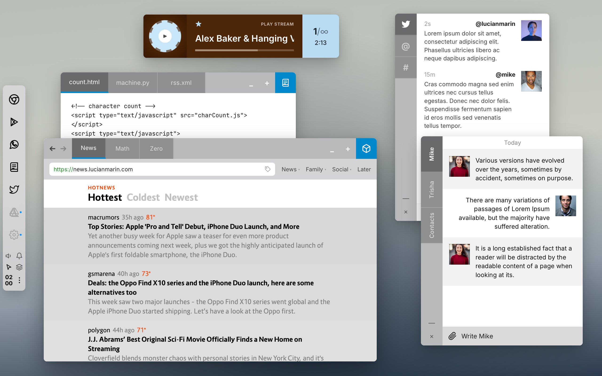

# Moss



**Experimental Operating System UI/UX Design & Human–Computer Interaction Prototype**

Moss is a next-generation desktop operating system concept designed by Lucian Marin. It reimagines how windows, navigation chrome, system docks, and ambient media coexist on a clutter-free spatial canvas. Built with **React** and **Vite**, this interactive environment unifies the **Moss V2** design language (primary experience) with all iconic applications and HUD paradigms from **Moss V1**.

---

## 1. Design Philosophy & HCI Principles

1. **Chromeless Brand-Header Windows (V2 Priority)**
   - Traditional title bars are eliminated. Each window merges its application icon, navigation tabs, and window actions (`Minimize`, `Close ⊗`) into a single brand-colored header bar:
     - **Chrome**: `#0c92ff` (Vibrant Blue)
     - **WhatsApp**: `#009988` (Teal Green)
     - **Code Editor**: `#4d4d4d` / `#0088cc` (Slate & Cyan Accent)
     - **Twitter**: `#6e6e6e` (Monochrome Sidebar Chrome)
     - **Media Player**: Dynamic album-palette surface (`#4d2608` / `#0d131a`)
     - **Finder & Settings**: `#2c2c2e` / `#3a3a3c` (Neutral Graphite)
   - Active tabs display bold typography with a crisp bottom indicator bar (`3px` white or cyan underline) directly inside the window header.

2. **Two Distinct UI Modes (`Basic` & `Advanced`) with Unified V1 + V2 Workspace**
   - **Basic Mode (Left Side Floating Dock — Default)**: Features the vertical floating dock (`#e0e0e0`) on the left side (`moss-v2-dock.jpg`) containing all V1 & V2 app icons and hover labels, integrated volume flyout, workspace layer toggle, and stacked vertical clock (`19` / `20`).
   - **Advanced Mode (Top Bar + Drop-Down App Switcher)**: Features the top system bar (`⚡` launcher, focused app title, dynamic context menus, volume control flyout, workspace overview, notifications, and `19:42` clock) paired with a top-left drop-down App Switcher stack displaying all V1 & V2 apps (`Chrome`, `Player`, `WhatsApp`, `Code`, `Twitter`, `Finder`, `Settings`) with their icons and names.
   - **Default Wallpaper**: Boots into **Alpine Mist** (`v1-mountain`) by default, with `Neutral Gray (#808080)`, `Deep Moss Slate`, and `Carbon Studio` selectable in Settings.

3. **Physics-Driven Window Lifecycle Animations**
   - **Opening (Spatial Bloom & Spring Morph)**: Windows originate from their trigger source (dock icon or top-left switcher stack) with 3D perspective tilt (`rotateX`, `scale`, `filter: blur`), settling via under-damped spring physics.
   - **Minimizing (Vector Fold to Stack / Dock)**: Minimizing a window calculates the real-time bounding box of the top-left switcher stack (or dock icon) and smoothly trajectories the window down into a compact pill card while preserving live state.
   - **Closing (Implosion & Momentum Dissolve)**: Clicking `⊗` triggers a gentle scale-down contraction with subtle upward drift and opacity fade, automatically focusing the next window in the z-stack.
   - **Focus & Drag Inertia**: Dragging windows applies subtle velocity-based tilt and elevation shadow expansion; unfocused windows subtly recede.

---

## 2. Applications & Feature Specifications

### V2 Core Applications
| Application | Design Source | Key Interactive Features |
| :--- | :--- | :--- |
| **Chrome Browser** | `moss-v2-dock.jpg`, `moss-v2-switcher.png`, `moss-v1-browser.jpg` | `#0c92ff` header with tabs: **Google** (interactive search, apps grid, profile switcher), **Subreply** (minimalist microblogging feed), **Hacker News** (live-styled stories, voting, reader view), and **Journal / lucianmarin.com** (V1 blog with *Design the Flying Car*, Archive, Links, Work, Themes, About), plus V1 **YouTube** (`apparat-song`) and **Reddit** modes. Editable URL bar, back/forward history, and bookmark bar toggle. |
| **WhatsApp Messenger** | `moss-v2-dock.jpg`, `moss-v2-switcher.png` | `#009988` header with **Mike**, **Trisha**, and **Contacts** tabs. Alternating `#f2f2f2` / `#ffffff` message rows with opposing avatars, attachment picker, live message composition (`Write Mike`), and intelligent simulated replies. |
| **Finder (Files)** | `moss-v2-switcher.png` | Browse `/design` (inspect original V1 & V2 mockups inside the OS), `music/` (launch the Chilltrax stream `https://streamssleu.chilltrax.com/stream?sid=1` directly in the Media Player), and `/code` (open `count.html`, `machine.py`, `rss.xml` in the Code Editor). |
| **Settings** | `moss-v2-switcher.png` | Customize Shell Mode (`V2 Complete`, `V2 Dock Only`, `V2 Switcher Only`, `V1 Classic Mountain`), Desktop Surface (`V2 Neutral Gray #808080`, `V1 Alpine Mist`, `Dark Obsidian`, `Warm Stone`), Animation Physics (`Spring Morph`, `Genie Fold`, `Crisp`), and System Audio Volume. |

### V1 Applications (Unified into Moss)
| Application | Design Source | Key Interactive Features |
| :--- | :--- | :--- |
| **Moss Media Player** | `moss-v1-player.jpg`, `https://streamssleu.chilltrax.com/stream?sid=1` | Ultra-minimal horizontal bar widget (`[Album Art] [★ Artist + Title + Progress] [Track # / Time]`). Powered by HTML5 Audio streaming `https://streamssleu.chilltrax.com/stream?sid=1` alongside V1 track skins (*Castanets — No Voice Was Raised*, *Caribou — Jamelia*, *Chilltrax Live*). Includes interactive progress scrubbing, star favorites, track cycling, and color-adaptive themes (`#4d2608` + `#b9dcf2` blue badge, `#0d131a` + `#ecc118` gold badge). |
| **Code Editor** | `moss-v1-code.jpg`, `moss-v1-laptop.jpg` | Multi-tab editor featuring `count.html`, `machine.py`, and `rss.xml`. Includes syntax highlighting, live editing, font scaling (`-` / `+`), interactive **Live Preview / Run** drawer (executes `charCount()` live!), and the V1 top-right blue menu (`New`, `Share`, `Settings`, `Quit`). |
| **Twitter Client** | `moss-v1-twitter.jpg`, `moss-v1-laptop.jpg` | Vertical left-rail navigation (`🐦 Timeline`, `@ Mentions`, `# Trends`) paired with a crisp right-aligned author feed (`lucianmarin`, `mike`), live relative timestamps (`2s`, `15m`), inline tweet composer, and integration with the V1 bottom notification ticker. |
| **V1 Right-Edge HUD & Volume** | `moss-v1-code.jpg` | Translucent right-edge quick tiles (Quick Notes, Messages, Trash, Volume) with a smooth slide-out horizontal volume bar (`0–100`) synced to the Media Player's gain node. |

---

## 3. Building Plan & Architecture

1. **Phase 1 — Project Scaffolding & Static Assets**
   - Initialize Vite + React (`package.json`, `vite.config.js`, `index.html`).
   - Connect the Media Player to `https://streamssleu.chilltrax.com/stream?sid=1` and expose `/design/*` so Finder can load authentic project mockups directly.
2. **Phase 2 — Spatial Window Manager & Animation Engine (`src/context/OSContext.jsx`, `src/components/WindowFrame.jsx`)**
   - Central window state machine managing position, size, z-index, active tab, open/minimized/closing lifecycle states, and origin coordinates for origin-aware animations.
   - Keyboard shortcuts (`Alt/Cmd + Tab` window cycle, `Esc` overview toggle, `Space` play/pause when player focused).
3. **Phase 3 — Shell Chrome (`src/components/TopBar.jsx`, `src/components/LeftDock.jsx`, `src/components/RightHud.jsx`, `src/components/BottomTicker.jsx`)**
   - Build the V2 Top Menu Bar + Minimized App Switcher Stack (`WhatsApp`, `Settings`, `Finder`), V2 Floating Left Dock (`moss-v2-dock.jpg`), and V1 Right Volume HUD + Bottom Ticker.
4. **Phase 4 — V2 & V1 Application Suite (`src/apps/*`)**
   - Implement `BrowserApp`, `WhatsAppApp`, `PlayerApp`, `CodeEditorApp`, `TwitterApp`, `FinderApp`, and `SettingsApp`.
5. **Phase 5 — Verification & Polish**
   - Test production build (`npm run build`) and verify live interactions, audio playback, and animation fluidity.

---

## 4. Running Locally

```bash
npm install
npm run dev
```

